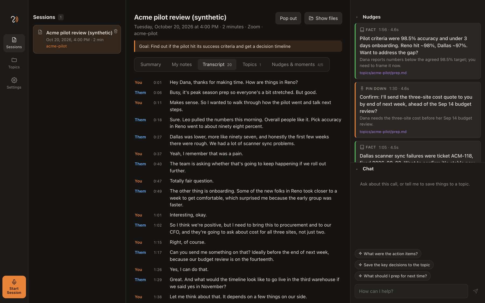

<p align="center">
  
</p>

<h1 align="center">Earshot</h1>

<p align="center">
  <b>A live call copilot that lives on your Mac.</b><br>
  It listens to both sides of a call, transcribes on your machine, and taps you on the shoulder only when it matters:<br>
  the question to ask, the fact you forgot, the promise to pin down.
</p>

<p align="center">
  <a href="https://github.com/kiamesdavies/earshot/releases/latest/download/Earshot_0.1.0_aarch64.dmg"><b>⬇ Download Earshot for macOS (.dmg)</b></a>
  &nbsp;·&nbsp;
  <a href="https://github.com/kiamesdavies/earshot/releases">All releases</a>
  &nbsp;·&nbsp;
  <a href="#build-from-source">Build from source</a>
</p>

<p align="center"><sub>macOS 26+ · Apple silicon · bring your own model · open source (MIT)</sub></p>



<sub>The demo call shipped in `fixtures/demo-call`. Every name and number in it is made up.</sub>

## Why Earshot

Meeting tools write you a summary after the call. By then the moment has passed. Earshot works **during** the call:

- **Nudges at the right moment.** When the other person finishes speaking or asks a question, Earshot decides whether anything is worth saying. Most of the time it stays quiet. When it speaks, it shows one short card: a **question** to ask, a **connection** to your notes, a **fact** you would have had to look up, or a **commitment** to pin down ("by end of next week, ahead of the Sep 14 budget review?").
- **It knows your context.** Each call can be linked to **topics**: folders of markdown with your prep docs and the notes from every earlier call on that topic. The copilot searches them live, and each nudge shows which file it came from.
- **Memory that builds.** When the call ends, Earshot writes a summary and your notes back into the topic, so the next call starts with the full history.
- **Private by default.** Speech is transcribed on your Mac with Whisper or Parakeet. Audio never leaves the machine. Only the text you choose to send goes to the model you chose.
- **Your models, your bill.** Use the Anthropic API, OpenAI, OpenRouter, any OpenAI-compatible server (Ollama, LM Studio, Groq), or the `claude`, `codex` and `kiro-cli` you already have installed.
- **Works with your tools.** Back a topic with a page in Spacesheep, Notion or any MCP server. Earshot pulls it before the call, and after the call a skill drafts the record and writes it back once you approve it.

## Features

| | |
|---|---|
| 🎙 **Both sides, separated** | Your mic is "You", system audio is "Them": speaker labels without guesswork. Echo cancellation stops your speakers being transcribed twice. |
| 🧠 **On-device transcription** | Whisper large-v3 turbo, Parakeet v3 and more, downloaded on request from an in-app catalog. Apple's on-device model shows live words while the better model catches up. |
| 💡 **Live nudges** | A cheap "speak or stay silent" gate, then a suggester that searches your topic notes. Timing, cooldown and strictness are all adjustable. |
| 🪟 **Floating window** | When you switch to Zoom, Meet or Teams, a small always-on-top card shows one nudge at a time. Step through cards with ← and →. Open it from any app with ⌃⌥N. |
| 📞 **Call detection** | Notices when another app starts using the mic and offers to start, like Granola. Stops by itself when the call ends. |
| 📁 **Topics as markdown** | Plain files in `~/Documents/Earshot`. Point it at an Obsidian vault if you like. |
| 💬 **Chat that does things** | "Save the key decisions to the topic", "append to prep.md that…", "rename this session". Tools can read and edit markdown but never delete. |
| 🔌 **MCP connectors** | OAuth sign-in in your browser, a pull before each session, a skill-drafted record after it, and a write-back only when you press Publish. **Test before & after** checks the whole loop without writing anything. |
| 📏 **Measurable** | Bookmark moments when you wished for a nudge (⌘B), then replay the call through any model and get precision, recall and latency. |

## Install

1. [Download the DMG](https://github.com/kiamesdavies/earshot/releases/latest/download/Earshot_0.1.0_aarch64.dmg) and drag **Earshot** into **Applications**.
2. The release is open source and not yet notarised by Apple, so the first launch is blocked. Open **System Settings → Privacy & Security**, scroll down and click **Open Anyway**. Or run:

   ```bash
   xattr -dr com.apple.quarantine /Applications/Earshot.app
   ```

3. Open Earshot. Go to **Settings → Permissions & audio check**, press **Request access**, then **Test audio**.
4. **Settings → Transcription:** download a model (Whisper large-v3 turbo is the recommended one, 574 MB).
5. **Settings → Models:** add a provider and press **Test**. The quickest start is one OpenRouter or Anthropic key with **Use one model for everything**.
6. Create a topic, drop in a prep doc, and press **Start Session** on your next call.

Requirements: macOS 26 or later on Apple silicon. Earshot uses `SpeechAnalyzer` and Core Audio process taps, which are new in macOS 26.

## Privacy

- Audio is recorded and transcribed on your Mac. It is stored only in `~/Library/Application Support/app.earshot.desktop/recordings` and deleted after 14 days by default (Settings → Storage).
- Transcripts, notes and chat are plain files in your data folder. Nothing is sent to a server Earshot runs: there isn't one.
- Text goes only to the model provider you configured. With a local model (Ollama, LM Studio), nothing leaves the machine.
- API keys and connector tokens are kept in the macOS keychain.
- Logs record errors and timings, never the words of a call.
- Recording laws differ: in some places everyone on a call must agree to it. Earshot reminds you on first run. Asking is your responsibility.

## How it works

```
 mic ──────────► "me"   ┐                    ┌──────────────┐   ┌──────────────┐   ┌───────────────┐
                        ├─► on-device STT ──►│   trigger    │──►│     gate     │──►│   suggester   │──► nudge card
 system audio ─► "them" ┘   (SpeechAnalyzer) │ (free, local)│   │ (cheap model)│   │ (+ BM25 over  │
   (Core Audio process tap)                  └──────────────┘   └──────────────┘   │  topic notes) │
                                               turn-end /         "speak or         └───────────────┘
                                               question /          stay silent"
                                               periodic
```

- **Two channels = free diarization.** The mic is "me", system audio is "them". Echo cancellation (voice processing) stops "them" being transcribed twice when you're on speakers.
- **Timing is the product.** A trigger fires only when *they* finish a turn (1.2 s of silence) or ask a question, with a cooldown between nudges. The gate model defaults to silence; the suggester can still decline. Everything is tunable in Settings → *When the copilot speaks*.
- **Call detection** watches Core Audio's process list for other apps using the mic (Zoom, Meet in a browser, Teams, FaceTime, Slack, WhatsApp…) and shows a small "Start?" card, like Granola.
- **Topics are folders of markdown** on disk — prep docs you write or upload, plus `sessions/` notes saved after each call. Point the data folder at an Obsidian vault if you like.

| Piece | Where |
|---|---|
| Audio sidecar (Swift): `watch`, `capture`, `transcribe`, `assets` | `audio/Sources/earshot-audio/` |
| Rust core: sidecar lifecycle, call-detected window, files, keychain, CLI runner | `src-tauri/src/` |
| Pipeline (no Tauri imports — also runs under Node) | `src/core/` (`copilot.ts`, `providers.ts`, `retrieval.ts`, `notes.ts`) |
| Live session controller + UI | `src/lib/live.ts`, `src/components/` |
| Replay harness | `scripts/replay.ts` |

## Build from source

You need the Xcode Command Line Tools (Swift 6), Rust, Node 22+, pnpm and `cmake` (whisper.cpp is compiled in): `brew install cmake`.

```bash
git clone https://github.com/kiamesdavies/earshot.git && cd earshot
pnpm install
pnpm build:audio          # builds the Swift audio sidecar into src-tauri/binaries/
pnpm tauri dev            # dev app (permission prompts are attributed to your terminal)
pnpm tauri build --bundles app,dmg   # Earshot.app + .dmg in src-tauri/target/release/bundle/
```

To preview the UI in a browser with a fake backend (it replays the demo call with canned nudges), run `pnpm dev` and open http://localhost:1420.

### Permissions

Open **Settings → Permissions & audio check** and press **Request access**. Two permissions are needed:

- **Microphone** (your side).
- **System Audio Recording** (their side), listed under Privacy & Security → Screen & System Audio Recording → *System Audio Recording Only*. macOS never prompts for this on its own: a Core Audio tap without permission silently records nothing. Earshot therefore asks TCC explicitly, the same way Apple's AudioCap sample does.

Then press **Test audio (6s)**. Talk, and play a video with speech. It shows the mic and system-audio peaks plus what was transcribed. If you switched a permission on in System Settings, quit and reopen Earshot.

Each local rebuild is ad-hoc signed with a new code hash, so macOS can end up holding a stale grant. If the test shows 0 after you've allowed access, reset and ask again:

```bash
tccutil reset Microphone app.earshot.desktop && tccutil reset AudioCapture app.earshot.desktop
```

## Transcription

Speech-to-text runs on the Mac with the same engines and model files as [Handy](https://handy.computer), through the `transcribe-rs` crate. Models aren't bundled, which keeps the app small. Settings → Transcription lists a catalog you can download and switch between:

| Model | Size | Notes |
|---|---|---|
| Whisper large-v3 turbo (recommended) | 574 MB | fast and accurate, takes vocabulary hints |
| Parakeet v3 | 671 MB | fastest, 25 European languages |
| Whisper large-v3 | 1.1 GB | most accurate, slowest |
| Whisper small (English) | 190 MB | light |

Downloads come from Hugging Face (`ggerganov/whisper.cpp`, `istupakov/parakeet-tdt-0.6b-v3-onnx`) into `~/Library/Application Support/app.earshot.desktop/models`. They resume after a cancel or a dropped connection.

Earshot also checks Handy's standard model folder (`~/Library/Application Support/com.pais.handy/models`). Any catalog model already there shows as installed and is used in place, so nothing is downloaded twice. You can also point at any other Whisper ggml `.bin` or Parakeet folder. On first launch, Earshot picks the best model already installed. If there's none, it uses Apple's on-device model, and the start dialog suggests downloading one.

How it works live: the sidecar's speech detector cuts each speaker's audio into phrases (a phrase ends after 750 ms of silence). Each phrase is transcribed by the local model, while Apple's on-device model shows gray live words in the meantime. Whisper gets a vocabulary prompt built from your Vocabulary setting, topic names, and names that recur in the topic notes.

Measured on a 72 s speakerphone recording from this Mac (M-series):

| Engine | Time per phrase | Notes |
|---|---|---|
| Whisper large-v3 q5_0 (Metal) | 0.7–1.3 s | Best accuracy. With vocabulary it got "Claude Haiku 5.5, OpenRouter" where Apple heard "Claude, EQ, 5.5, Uper Alta". |
| Parakeet TDT 0.6B v3 int8 | 0.07–0.5 s | Fastest. No vocabulary biasing, and weaker on product names. |
| Apple SpeechAnalyzer | streaming | No download, weakest on this mic. |

`cargo run --release --example stt_pipeline -- whisper <model.bin> <file.wav> "<vocabulary>"` (in `src-tauri/`) replays a recording through the same path and prints each phrase with its transcription time.

## Models

Settings → Models. **Use one model for everything** sets all jobs at once. Each provider has a **Test** button. Each job can also have its own provider + model:

| Role | Runs | Pick |
|---|---|---|
| Gate | every turn-end | fastest/cheapest (default: Haiku via OpenRouter). Not a CLI — process startup costs seconds. |
| Suggestions | when the gate says speak | fast |
| Chat | your questions | anything |
| Notes | once per call | quality; CLIs are fine here |

API keys go in the macOS keychain (service `app.earshot.desktop`). Reasoning is switched off on the live path — reasoning models otherwise spend the whole token budget thinking and return nothing.

**CLI providers** (Claude Code, Codex, Kiro, or any other command) are a command plus an argument template: `{model}` and `{prompt}` are filled in, and without `{prompt}` the prompt goes on stdin. Earshot resolves commands through your interactive login shell, so tools installed into `~/.local/bin` via `.zshrc` are found. If one still isn't found, paste the full path (`which claude`). Presets:

| CLI | Command | Notes |
|---|---|---|
| Claude Code | `claude -p --output-format text --model {model}` | model: `sonnet`, `haiku`, `opus` or blank |
| Codex | `codex exec --skip-git-repo-check --sandbox read-only --model {model} -` | read-only, so file changes only go through Earshot's tools; with a ChatGPT login pick a supported model (e.g. `gpt-5.6-terra`) |
| Kiro | `kiro-cli chat --no-interactive --wrap never {prompt}` | uses Kiro's selected model; needs `kiro-cli login` or `KIRO_API_KEY` |

CLIs take seconds to tens of seconds per call. They're fine for summaries and chat, but too slow for the nudge gate.

**About subscriptions:** the CLI providers run *your* installed `claude` / `codex` with *your* login on *your* Mac. Whether a consumer subscription may be used this way is governed by each provider's current terms — check them before relying on it, especially before sharing the app. API keys and local models are unambiguous.

## Recordings, storage and auto-stop

- **Text stays in the data folder** (`~/Documents/Earshot` by default, which may be in iCloud Drive): transcripts, notes, chat and nudges.
- **Audio stays on this Mac:** `~/Library/Application Support/app.earshot.desktop/recordings/<session>/me.m4a, them.m4a`, as AAC at about 20 MB per hour per side. It never goes to the iCloud-synced folder.
- **Keep call audio:** Settings → Storage. Choose don't keep / 7 / 14 (default) / 30 days / forever. Old audio is deleted when the app starts. Text is never deleted.
- **Auto-stop:** a session stops by itself 2 minutes after the call app releases the mic with no further speech, after 15 minutes with no one speaking, or at 4 hours. All three are adjustable, and 0 turns a rule off.

## Floating nudge window

During a call, switching away from Earshot pops out a small always-on-top window, like Teams' compact meeting view. You can also open it yourself, for a live or a past session, with **Pop out** or **⌃⌥N** from any app. It shows the live session if there is one, otherwise the session open in Earshot. It shows one nudge or fact at a time:

- ← / → or the arrows step through them, and the dots jump to a card.
- A newer nudge shows a "N newer" chip, so you aren't pulled away from the card you're reading.
- Drag it anywhere, for example the middle of the screen, and it remembers the position.
- Esc hides it. The bookmark marks a moment, and the expand icon returns to Earshot.
- It hides itself when you come back to Earshot, unless you popped it out by hand. Turn the automatic pop-out off in Settings → Audio & calls.

In the main window, click the **Nudges** or **Chat** heading to collapse that section. Collapse both and the panel shrinks to a thin strip, giving the transcript or notes the full width. The layout is remembered.

## Connector-backed topics (MCP integrations)

A topic can be backed by a page in Spacesheep, Notion or any MCP server.

- **Settings → Integrations:** connect a server. Sign-in uses the standard MCP OAuth flow in your browser (dynamic client registration and PKCE), and tokens go in the keychain. **Test** lists the server's tools and checks the adapter mapping against them.
- **Topics → Link to a connector:** choose the connector, the document (for example space and file), when to refresh, and optionally a post-session skill.
- **Beginning of a session:** the source is pulled into `topics/<slug>/linked/` as a read-only copy, so nudges, chat and summaries use it like any topic file.
- **End of a session:** the skill (for example `~/.agents/skills/weekly-meeting`) drafts the record from the transcript, your notes and the summary. It can read through the connector's read-only tools but can't write. The draft appears in the session's Summary tab. **Publish** writes it back (for Spacesheep: one `create_version` replacement under the marker line), then refreshes the copy so the next session continues from it.

**Test before & after** on a linked topic checks everything a session relies on, without publishing:
- **Connection:** signed in, and the tools are there.
- **Before a session:** the real pull into `linked/`.
- **After a session:** the skill loads, the marker appears exactly once in the pulled file, and the write is validated against the tool's schema without being sent.

**Draft a sample record** then runs the skill on the topic's latest session, so you can see the output before a real call.

Connectors share one interface: `read`, `write` (`insert-after-marker` or `append`), and the read-only tools an agent may use. Each one maps that interface onto its own server's tools with a small JSON adapter (`src/core/connectors.ts`). A server with no mapping, such as Notion today or a custom server, works through an agent that's given the server's tools. Its write tools are offered only after you press Publish.

## Logs and diagnosing problems

Every audio, transcription, model and UI error is logged, but never the words of the call:

- **File:** `~/Library/Logs/Earshot/earshot.log` (rotates at 5 MB). Settings → Permissions → **Show logs** opens the folder, and Console.app lists it under Log Reports.
- **macOS unified log**, subsystem `app.earshot.desktop`:

```bash
log show --last 1h --style compact --predicate 'subsystem == "app.earshot.desktop"'
```

- **Headless self-test:** `open -n /path/to/Earshot.app --args --selftest` records 8 s (mic plus system audio) using Earshot's own permissions. It logs every Core Audio step, writes `~/Library/Logs/Earshot/selftest.json`, then quits.

## Your notes, topics and the assistant

- **My notes** (a session tab) is your own scratchpad, saved as you type. Those notes and the transcript together produce the summary. Both are saved into every linked topic as `topics/<topic>/sessions/<date>-<title>-<time>.md`, so the next call on that topic starts with the full history.
- **Topics tab** on a session: attach or detach topics, even mid-call, and see exactly which files the copilot can read.
- **Untitled sessions** are named from the conversation after about a minute (or when they end). Click any title to rename it.
- **Chat takes actions.** In a session or a topic you can say "add this as a markdown file", "append to prep.md that…", "add that to my notes", "attach the acme topic" or "rename this session". The assistant uses tools that can read, search, create and edit markdown under `topics/`, plus your session notes. It can't delete anything. HTTP providers use native tool calling, and CLIs use a tagged-JSON protocol.
- **Deleting** a session moves its folder to the macOS Trash.

## Measuring whether nudges are any good

The ground truth is you. During a call, press the bookmark (⌘B) whenever you wish you'd had a nudge, and type a few words about what you needed. Those land in `sessions/<id>/moments.json` next to `transcript.jsonl` and the two WAVs.

Then replay the call through the copilot with any model and score it:

```bash
pnpm replay ~/Documents/Earshot/sessions/<id> --data-root ~/Documents/Earshot
pnpm replay <dir> --gate openrouter:google/gemini-3.5-flash-lite --suggest anthropic:claude-haiku-5-5 --runs 3
pnpm replay <dir> --transcribe     # re-run on-device STT from me.wav / them.wav first
```

It reports **precision** (nudges that matched a marked moment), **recall** (moments that got a nudge), and **latency** p50/p95 (end of their speech → card on screen), and saves a markdown + JSON report under `<dir>/replays/`. A nudge only counts if it lands within −45 s / +10 s of a moment **and** a judge model agrees it addresses what you wrote (`--no-judge` for time-only matching, which over-credits).

Model calls are real; session time is simulated and advanced by the actual wall-clock time the models took, so latency is what you'd see live minus real STT jitter (assumed 0.4 s, `--stt-delay`).

### Current numbers (synthetic call — not a quality claim)

`fixtures/demo-call` is a scripted 2-minute pilot review with a prep doc and 5 marked moments. With Haiku 5.5 as gate + suggester over 3 runs: **precision 0.25, recall 0.20, latency p50 4.5 s / p95 5.5 s** (≈1.2 s silence wait + 0.4 s STT + ~2.8 s for two model calls). Two failure modes are visible in the reports: the 20 s cooldown swallowed the turn where the Dallas ticket was relevant, and the suggester sometimes adds a month to a bare date ("Sep 14"). Don't tune against this fixture — record five real calls with marked moments and tune against those.

## Data layout

```
~/Documents/Earshot/
  topics/<topic>/*.md                 your prep docs
  topics/<topic>/sessions/<date>-<title>.md   notes + transcript from each linked call
  sessions/<id>/session.json  transcript.jsonl  suggestions.jsonl  moments.json  chat.json  notes.md  me.wav  them.wav
```

## Signing and notarising your own build

`pnpm tauri build` produces an **ad-hoc signed** app, like the release DMG. For a build that opens without any Gatekeeper warning you need an Apple Developer ID certificate and notarisation: set `APPLE_SIGNING_IDENTITY`, `APPLE_ID`, `APPLE_PASSWORD` and `APPLE_TEAM_ID`, then run `pnpm tauri build`. Tauri signs and notarises both the app and the audio sidecar.

The first-run screen reminds users that some places require everyone on a call to consent to recording.

## Known gaps

- Tested on this Mac: mic capture with and without echo cancellation, streaming on-device transcription (`earshot-audio simulate`), the tool-using agent through OpenRouter and the Codex CLI. Not yet tested: the system-audio grant inside the bundled app, which needs a person to click the macOS prompt.
- Retrieval is BM25 over markdown chunks — no embeddings yet, so paraphrases without shared words won't connect.
- Gate and suggester are two sequential calls; a single-call mode would cut ~1 s of latency at some cost in precision. Measure before switching.
- macOS only.

## Contributing

Issues and pull requests are welcome. Useful places to start:

- **New connectors.** A connector is a small JSON adapter in `src/core/connectors.ts` that maps `read`, `write` and an options list onto one MCP server's tools. A declarative Notion mapping would be a great first PR.
- **Better nudges.** Record real calls, bookmark the moments you wanted help, and use `pnpm replay` to compare prompts and models. Please share numbers with any change to the copilot.
- **Retrieval.** Topic search is BM25 today. Embeddings would connect paraphrases.

Run `pnpm typecheck` before sending a PR.

## License

[MIT](LICENSE)
