# How to use Earshot

A step-by-step guide, from first launch to meeting notes that write themselves. Each section stands on its own, so jump to the one you need.

1. [First launch and permissions](#1-first-launch-and-permissions)
2. [Download a speech model](#2-download-a-speech-model)
3. [Connect your AI models](#3-connect-your-ai-models)
4. [Run your first session](#4-run-your-first-session)
5. [Set up a topic (no MCP needed)](#5-set-up-a-topic-no-mcp-needed)
6. [Choose how a topic's summaries look (skills)](#6-choose-how-a-topics-summaries-look-skills)
7. [Link a topic to Spacesheep, Notion or any MCP server](#7-link-a-topic-to-spacesheep-notion-or-any-mcp-server)
8. [Draft meeting notes automatically after a call (post-session hook)](#8-draft-meeting-notes-automatically-after-a-call-post-session-hook)
9. [How memory and compaction work](#9-how-memory-and-compaction-work)
10. [Troubleshooting](#10-troubleshooting)
11. [Send feedback](#11-send-feedback)

---

## 1. First launch and permissions

1. [Download the DMG](https://github.com/kiamesdavies/earshot/releases/latest/download/Earshot.dmg), open it and drag **Earshot** into **Applications**.
2. The first time, macOS blocks it because the build isn't notarised. Open **System Settings → Privacy & Security**, scroll down and click **Open Anyway**. Or run this once:

   ```bash
   xattr -dr com.apple.quarantine /Applications/Earshot.app
   ```

3. Earshot asks you to confirm that you'll respect recording laws (some places require everyone on a call to agree). Accept to continue.
4. Go to **Settings → Permissions & audio check** and press **Request access**. Earshot needs two permissions:
   - **Microphone**, for your side of the call.
   - **System Audio Recording**, for the other side. macOS lists it under *Privacy & Security → Screen & System Audio Recording → System Audio Recording Only*.
5. Press **Test audio (6s)**. Say something, and play a video with speech. You should see both levels move and the words transcribed.

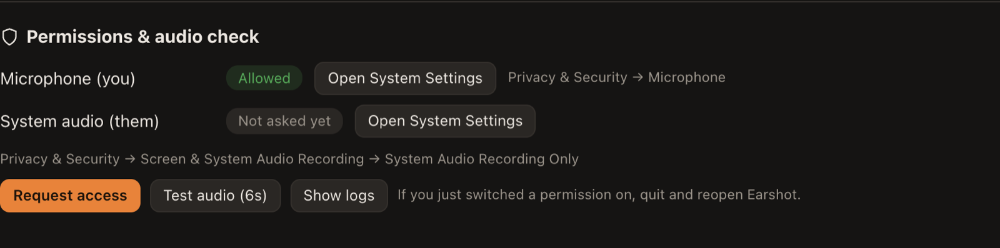

If you've just switched a permission on in System Settings, quit and reopen Earshot. If the test still shows nothing, see [Troubleshooting](#no-audio-from-the-other-side-or-from-the-mic).

## 2. Download a speech model

Speech is turned into text on your Mac. Nothing is sent anywhere for transcription.

1. Go to **Settings → Transcription**.
2. Press **Download** next to **Whisper large-v3 turbo** (574 MB, recommended). Downloads resume if you cancel or lose the connection.
3. Once it's installed, click it to make it the active model.

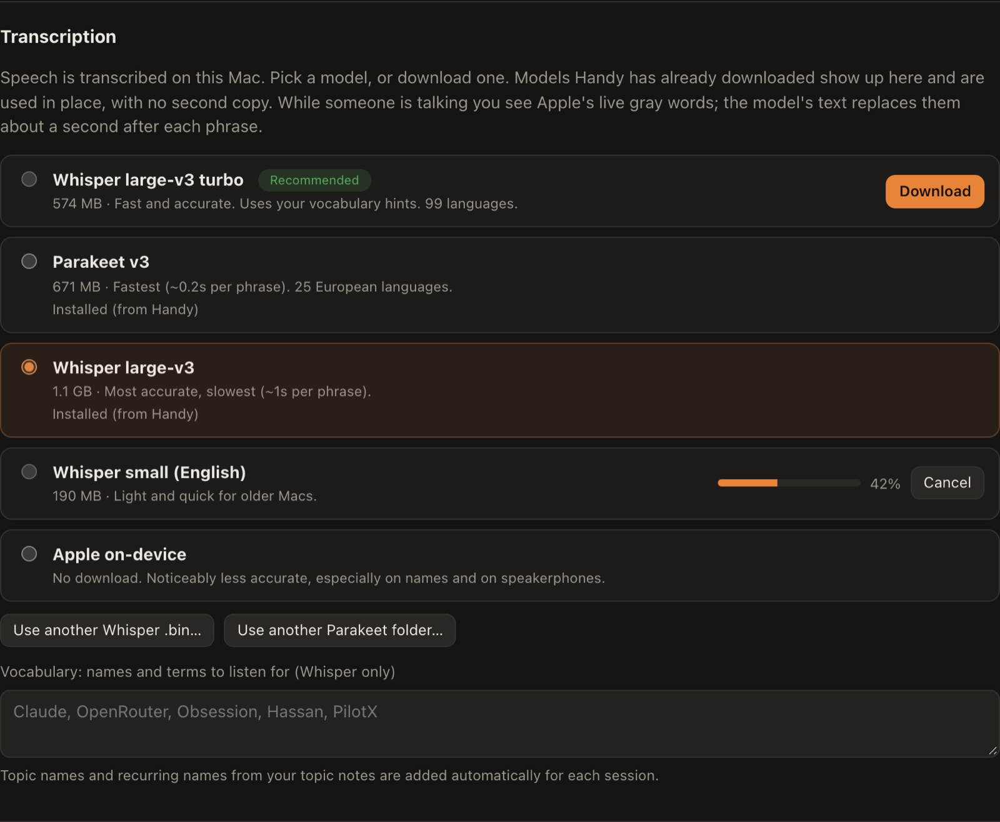

| Model | Size | Pick it when |
|---|---|---|
| Whisper large-v3 turbo | 574 MB | You want the best balance. Uses your vocabulary hints. |
| Parakeet v3 | 671 MB | You want the fastest, in one of 25 European languages. |
| Whisper large-v3 | 1.1 GB | Accuracy matters more than speed. |
| Whisper small (English) | 190 MB | You have an older or busier Mac. |
| Apple on-device | none | You haven't downloaded anything yet. It works, but it's weaker on names. |

**Tip:** add names and jargon you use (people, products, companies) under **Vocabulary**. Whisper uses them as hints. Topic names and names that recur in your topic notes are added automatically.

If you use [Handy](https://handy.computer), any model it has already downloaded shows as installed and is used in place, so nothing is downloaded twice.

## 3. Connect your AI models

The models write the nudges, answer your questions and write summaries. You choose which ones, and you pay the provider directly.

1. Go to **Settings → Models**.
2. Under **Providers**, add a key for one of them (Anthropic, OpenRouter, OpenAI) and press **Test**. Keys are stored in the macOS keychain.
3. The quickest setup: under **Use one model for everything**, pick the provider, type a model (for example `anthropic/claude-haiku-5.5` on OpenRouter) and press **Apply to all**.

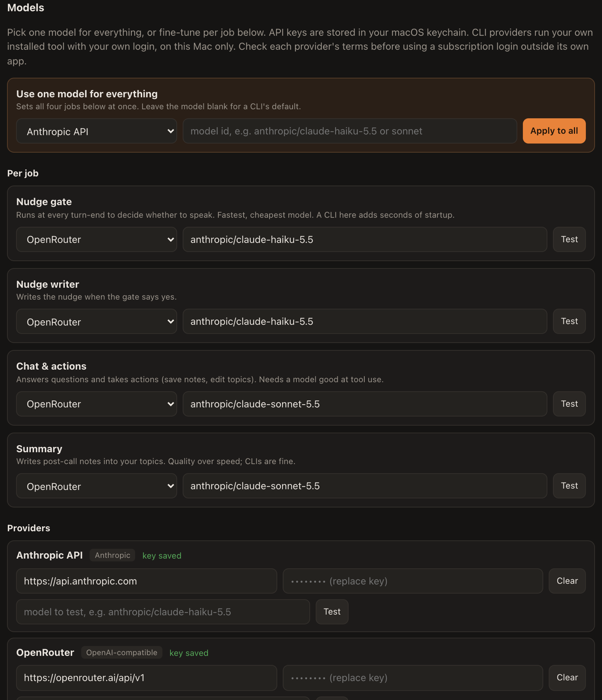

Earshot gives the model four jobs. You can give each its own model:

| Job | When it runs | What to pick |
|---|---|---|
| **Nudge gate** | Every time the other person stops talking | The fastest, cheapest model. Not a CLI: starting a process takes seconds. |
| **Nudge writer** | When the gate decides a nudge is worth it | Fast. |
| **Chat & actions** | When you ask something or ask it to save something | A model that's good with tools. |
| **Summary** | Once per call, and to update the topic's memory | Quality over speed. CLIs are fine here. |

**Other ways to run models:**

- **Free and local:** run [Ollama](https://ollama.com) or [LM Studio](https://lmstudio.ai). Earshot already lists both (`http://localhost:11434/v1` and `http://localhost:1234/v1`), and nothing leaves your Mac.
- **Your installed CLIs:** Claude Code (`claude`), Codex (`codex`) and Kiro (`kiro-cli`) are found automatically. They use your own login. They're too slow for the nudge gate, but fine for chat and summaries. Check each provider's terms before using a subscription this way.
- **Any OpenAI-compatible server:** Groq, Together, a company gateway. Add it with its base URL and key.

## 4. Run your first session

1. Press **Start Session** (bottom left), or join a call: when another app starts using the mic, Earshot offers to start.
2. In the dialog:
   - **Topics:** pick what this call is about, or type a new name to create one. The copilot reads these topics during the call, and the notes are saved back into them.
   - **Title:** optional. Leave it blank and Earshot names the call from the conversation.
   - **Goal:** optional, one sentence. The copilot only speaks up when it helps with this.
3. Press **Start listening**.

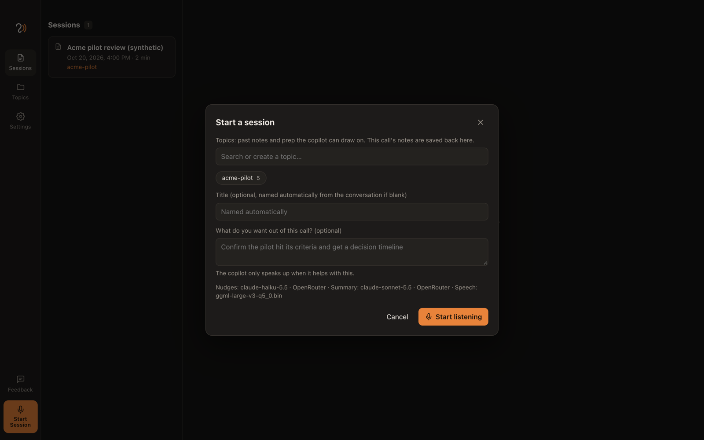

**During the call:**

- **Nudges** appear on the right only when they're worth it: a question to ask, a connection to your notes, a fact, or a commitment to pin down. Each one shows the file it came from.
- **Switch to your call app** and a small floating window shows one nudge at a time. Use ← → to step through them. **⌃⌥N** opens it from any app.
- **My notes:** type what matters to you. Your notes steer the summary.
- **⌘B bookmarks a moment** when you wished you'd had help. Add a few words if you like. The topic learns from these (see [section 9](#9-how-memory-and-compaction-work)).
- **Chat:** ask "what did they say about pricing?", or tell it "add that to my notes".

**Ending the call:** press **Stop**, or just hang up. Earshot follows the app the call is in. When that app releases the mic, a toast says the call ended, and the session stops itself 30 seconds later unless someone speaks. Press **Keep listening** to carry on. You can change the delay in **Settings → Stop automatically**. The "Start?" card that pops up when a call begins closes by itself once a session is running.

**When the session stops**, Earshot writes the summary, saves it into each topic, and updates each topic's memory.

**Opening past sessions:** the list shows every session straight away and fills in each one as it loads, with a progress bar. If your data folder is in iCloud Drive, sessions iCloud has moved off your Mac show "in iCloud" while they download.

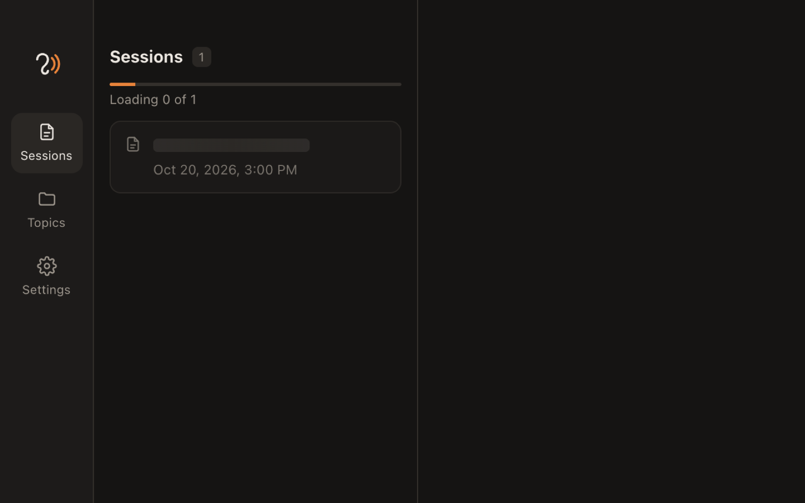

## 5. Set up a topic (no MCP needed)

A topic is a person, deal, project or meeting you have recurring calls about. It's a folder of markdown files on your Mac, and the copilot's main source of context. For the full picture, read [Topics and sessions](topics-and-sessions.md).

1. Go to **Topics** and press **+**. Give it a name, for example "Acme pilot".
2. Earshot creates `prep.md` and opens it. Write what you know: people and their roles, numbers, what was agreed, what you want from the next call.
3. Add more files any way you like:
   - **New note** writes one in the app.
   - **Upload .md** copies in markdown or text files you already have.
   - **Chat:** "create a pricing note with …", "append to prep.md that Dana prefers email".
   - **Finder:** drop files straight into `~/Documents/Earshot/topics/<topic>/`. Point it at an Obsidian vault if you like.
4. Pick the topic when you start a session.

After each call, the topic gets a note in `sessions/`, and its **memory.md** is updated. You don't need MCP for any of this.

## 6. Choose how a topic's summaries look (skills)

Every topic can have its own summary format. A sales call, a weekly team meeting and a one-to-one need different notes.

1. Open the topic. Under **How this topic learns → Summary format**, press **Change**.
2. Choose one of three options:
   - **Earshot's default format:** summary, decisions, to-dos, open questions, what changed, highlights.
   - **A skill:** the path to a folder with a `SKILL.md`, or to any `.md` file, for example `~/.agents/skills/weekly-summary`. These are the same skills you'd give Claude Code or another agent, so you can reuse one you already have.
   - **A format I write here:** a few headings with a line about each.
3. Press **Save**. For a skill, Earshot loads it first and tells you if it can't.

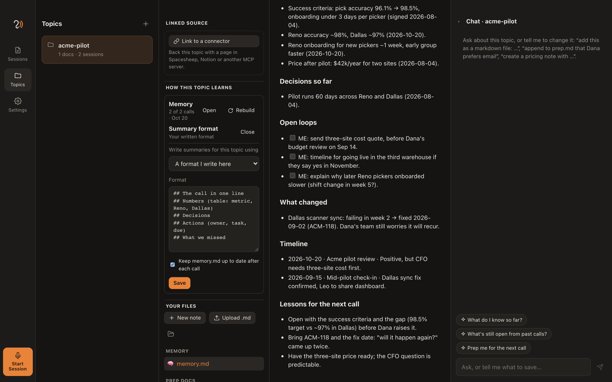

The format is used for the Summary tab and for the note saved in the topic. If one call belongs to two topics with different formats, each gets its own version. There's an example skill in [Topics and sessions](topics-and-sessions.md#your-summary-format-bring-a-skill).

## 7. Link a topic to Spacesheep, Notion or any MCP server

Link a topic when the knowledge lives somewhere your team and their AI agents already read: a Spacesheep page, a Notion page, or anything else with an [MCP](https://modelcontextprotocol.io) server. Before each call, Earshot pulls the linked page into the topic, so the copilot knows what the team knows.

### Connect the server (once)

1. Go to **Settings → Integrations**.
2. Press **Connect** next to Spacesheep or Notion. Your browser opens to sign in, and the token is stored in the keychain. For another server, press **Add MCP server** and paste its URL.
3. Press **Test**. Earshot lists the server's tools and checks that everything it needs is there.

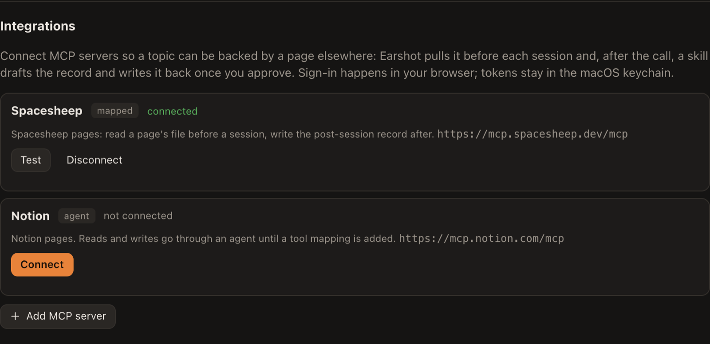

### Link the topic

1. Open the topic and press **Link to a connector** (under **Linked source**).
2. Choose the **connector** and the document:
   - **Spacesheep:** the **space** (`@you/page-name`), then pick the **file** from the list, for example `docs/meetings.md`.
   - **Notion:** the page URL.
3. **Section to open** (optional): an anchor like `#agenda`, used by the **Open** button.
4. **Refresh:** **Before each session** (recommended) or **Only when I press Refresh**.
5. Press **Save**. Earshot pulls the page into `topics/<topic>/linked/` as a read-only copy.

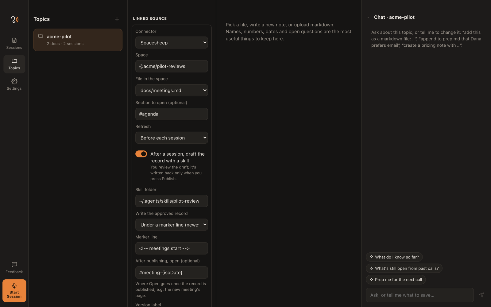

**Already have the doc?** Link straight to it. There's nothing to import and nothing to copy: point the link at your existing page and file, and it's pulled before every call from then on. Your own prep files stay alongside it.

**Without a post-session skill**, the link only reads: the copilot uses the page, and nothing is ever written back. Section 8 adds the write-back.

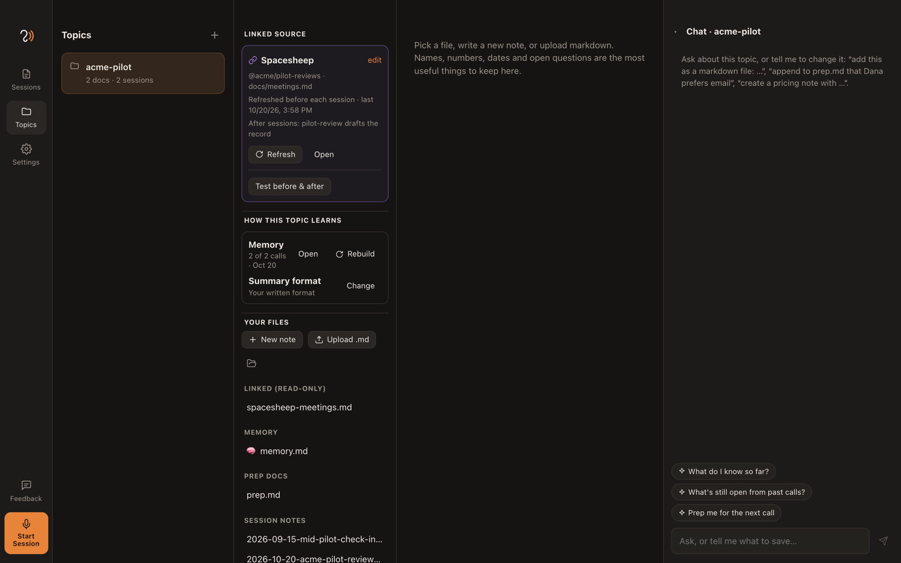

## 8. Draft meeting notes automatically after a call (post-session hook)

This is for meetings that keep a record somewhere shared, such as a weekly team meeting whose notes live on a Spacesheep page. After the call, a skill drafts this week's record. You review it, and Earshot writes it back only when you press **Publish**.

### Set it up

1. Link the topic (section 7), then press **edit** on the link.
2. Switch on **After a session, draft the record with a skill**.
3. Fill in:
   - **Skill folder:** the skill that knows how your record looks, for example `~/.agents/skills/weekly-meeting`.
   - **Write the approved record:** **Under a marker line (newest first)** or **At the end**.
   - **Marker line:** a line that appears exactly once in the file, which new records go under, for example `<!-- meetings start -->`. Earshot suggests the comment lines it finds in the pulled file. Pick one rather than typing it, because macOS can turn `--` into a dash.
   - **After publishing, open** (optional): where **Open** goes once the record is published, for example `#meeting-{isoDate}` for a page per meeting.
   - **Version label:** for example `Weekly meeting {date}`. You can use `{title}`, `{date}` (Sun 8 Nov 2026) and `{isoDate}` (2026-11-08).
4. Press **Save**, then **Test before & after**. It checks everything without writing anything:
   - **Connection:** signed in, and the tools are there.
   - **Before:** the pull works.
   - **After:** the skill loads, the marker appears exactly once, and the write would be accepted.
5. Optional: **Draft a sample record** runs the skill on the topic's latest session, so you can see the output before a real call. It never publishes.

### After each call

1. Stop the session. When the summary is done, the skill drafts the record (it can read the page, but can't write to it).
2. Open the session's **Summary** tab. The draft appears in a card marked **draft · needs your review**.
3. **Edit** it if you need to, then press **Publish to Spacesheep**. Or **Discard** it, or **Draft again**.
4. Earshot checks the marker is still in the page, writes the record as a new version, refreshes the topic's copy and shows **Open in Spacesheep**. The next call starts from the updated page.

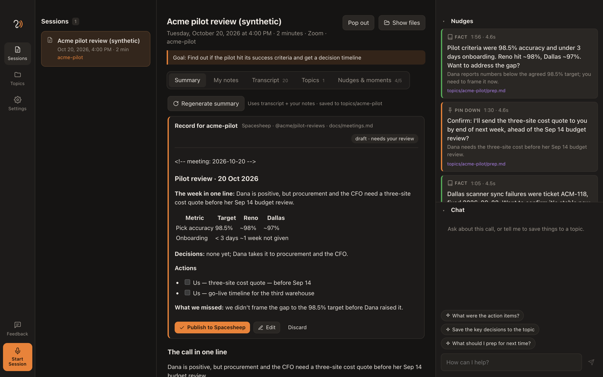

If anything fails, the card says why, and nothing is written. For example: the marker isn't in the page, or the server refused the change.

## 9. How memory and compaction work

Each topic keeps a **memory.md**: one file that holds what's still true after every call.

- **After each call**, the model folds the call into memory.md. The summary, your notes and your ⌘B bookmarks go in, and the file is rewritten:
  - **In one line:** where things stand.
  - **People.**
  - **Facts and numbers**, with dates.
  - **Decisions.**
  - **Open loops:** owner, task, due date.
  - **What changed.**
  - **Timeline.**
  - **Lessons for the next call:** learned from the moments you bookmarked.
- **Before each call**, the model reads memory.md, your prep docs and only the **last 3 calls in full**. That's the compaction: older call notes stay on disk and in search (a nudge can still quote one), but they no longer fill up the context. A topic with 300 calls costs about the same as one with 3, and nothing is silently dropped.
- **It's your file.** Under **How this topic learns → Memory**, press **Open** to read or edit it. Your edits are kept unless a later call contradicts them.
- **Rebuild** re-reads every saved call from the start, one model call each. Use it after editing old notes, or to give an existing topic a memory.
- **Each call is folded in once.** Regenerating a summary doesn't count it twice.
- **Turn it off** for a topic under **Summary format → Change**.

More detail in [Topics and sessions → How a topic learns](topics-and-sessions.md#how-a-topic-learns).

## 10. Troubleshooting

### Sessions take a long time to open

Your data folder (`~/Documents/Earshot`) is probably in iCloud Drive with **Optimize Mac Storage** on, so macOS moves older files to iCloud and has to download them when you open a session. The session list shows "in iCloud" for these. Two fixes:

- In Finder, right-click the **Earshot** folder in Documents and choose **Keep Downloaded**.
- Or move the data folder somewhere that isn't synced, and choose the new folder in **Settings → Storage → Data folder**.

### No audio from the other side, or from the mic

Each build of the app has a new code signature, so macOS can keep an old permission that no longer applies. Reset it and ask again:

```bash
tccutil reset Microphone app.earshot.desktop && tccutil reset AudioCapture app.earshot.desktop
```

Then reopen Earshot and press **Request access**.

### A CLI says "not found"

Earshot looks commands up through your login shell. If it still can't find one, run `which claude` (or `codex`, `kiro-cli`) in Terminal and paste the full path into the provider.

### Publish says the marker isn't there

The marker line must appear exactly once in the page, exactly as typed. Edit the link and pick the marker from the suggestions instead of typing it. **Test before & after** catches this.

### Anything else

Earshot logs every error, but never what was said on a call:

- **Settings → Permissions → Show logs** opens `~/Library/Logs/Earshot/earshot.log`.
- In Terminal: `log show --last 1h --style compact --predicate 'subsystem == "app.earshot.desktop"'`

## 11. Send feedback

Press **Feedback** in the sidebar. Choose **Something's broken**, **An idea** or **A question**, write a title and a few lines, and press **Open on GitHub**. Your browser opens a prefilled issue for you to check and submit. Nothing is sent from the app, and no transcripts or notes are included.

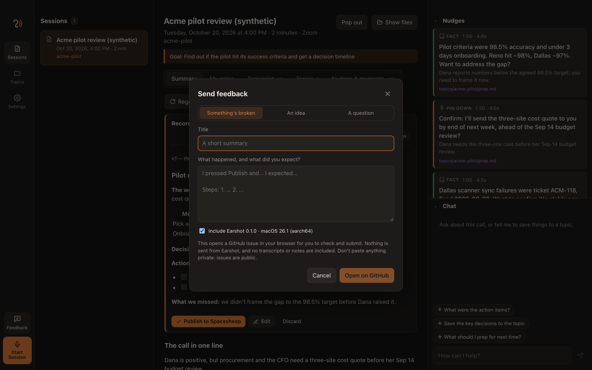
