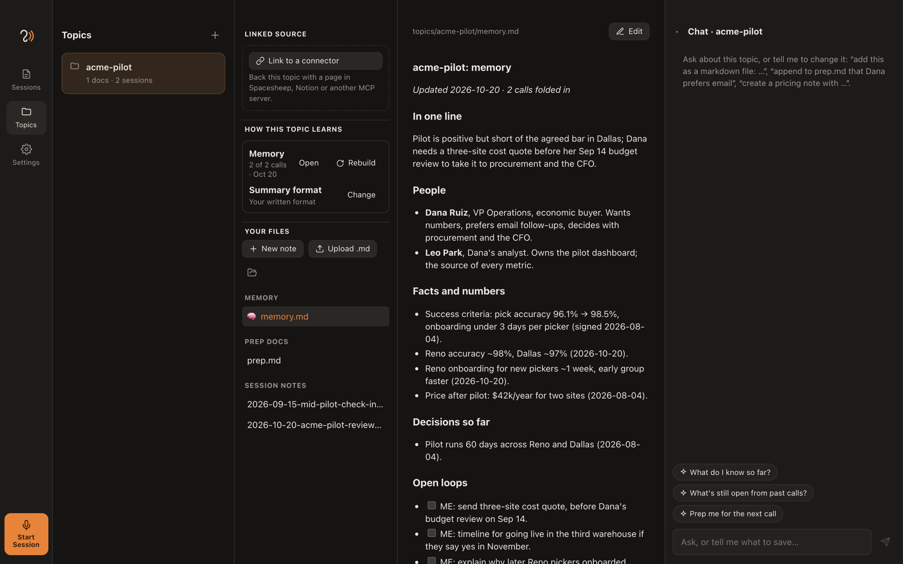
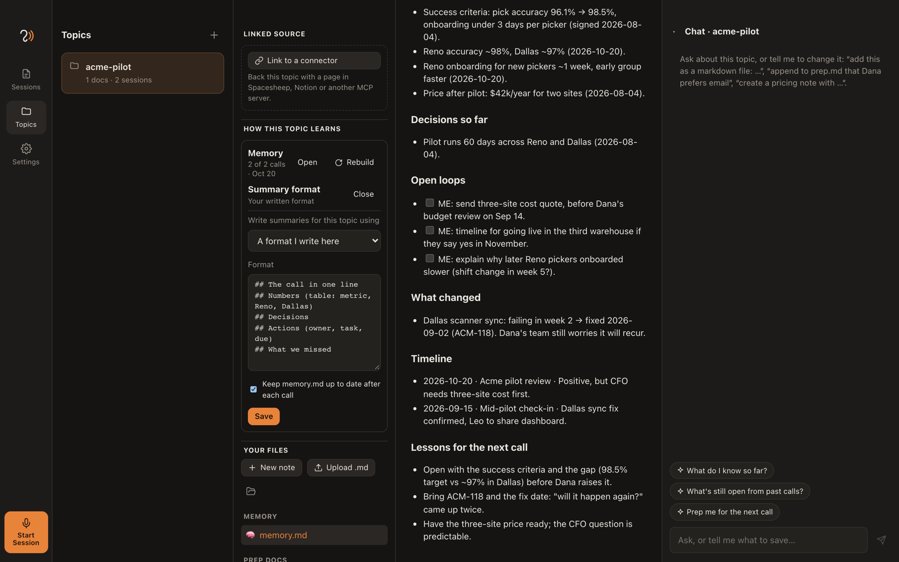
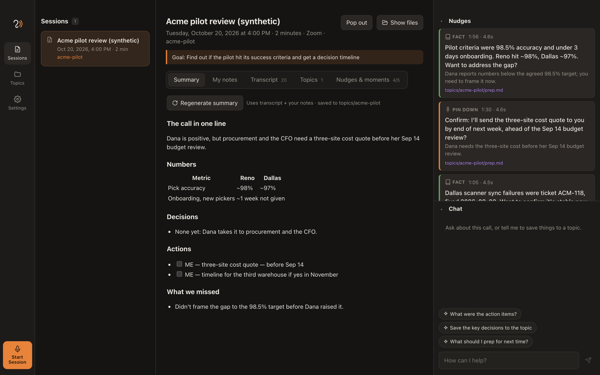

# Topics and sessions

Earshot has two kinds of things, and the difference between them matters:

- A **session** is one call. It's a scratchpad: the transcript, the notes you type, the nudges you saw and the chat. It belongs to that call.
- A **topic** is what the call was about: a person, a deal, a project, a weekly meeting. It's a brain: everything worth keeping from every call about it, plus whatever you wrote yourself. It belongs to you, and it gets better with every call.

A session is where you think during a call. A topic is what's still true after the call ends.



## Sessions: the scratchpad

When you press **Start Session**, Earshot opens a scratchpad for the call:

| Tab | What it holds |
|---|---|
| **Transcript** | Both sides, labelled You and Them, transcribed on your Mac. |
| **My notes** | Your own notes, saved as you type. They steer the summary, so write down what matters to you. |
| **Nudges & moments** | Every nudge the copilot showed, and every moment you bookmarked with ⌘B because you wanted help. |
| **Topics** | Which topics this call reads from and writes to. You can change them mid-call. |
| **Summary** | Written when the call ends, in the format the topic asks for. |

A session lives in `sessions/<id>/` and is never shared on its own. When it ends, the useful parts move into the topic. That's the point of the scratchpad.

## Topics: the brain

A topic is a folder of markdown files in your data folder (`~/Documents/Earshot/topics/<topic>/`):

```
topics/acme-pilot/
  memory.md              the brain: what we know, kept up to date after every call
  prep.md                your own docs: write them, upload them, or ask the chat to
  sessions/              one note per call, in this topic's summary format
    2026-09-15-mid-pilot-check-in-160000.md
    2026-10-20-acme-pilot-review-150000.md
  linked/                read-only copies of connected sources (Spacesheep, Notion, …)
  topic-settings.json    this topic's summary format and memory settings
```

During a call, the copilot searches every file in the topic for connections and facts. Each nudge names the file it came from, so you can check it. The chat on the Topics page can read and edit the same files: "append to prep.md that Dana prefers email", "what's still open from past calls?".

Because it's plain markdown, a topic works with anything else that reads files: Obsidian, a git repo, your editor, or an AI agent pointed at the folder.

## How a topic learns

Every call makes the topic a little smarter. When a session ends:

```
 call ends
   │
   ├─► summary, written in the topic's own format ──► sessions/<date>-<title>.md
   │
   └─► the summary, your notes and your ⌘B bookmarks are folded into memory.md
           │
           ▼
 next call on the topic starts from memory.md + your prep docs + the last 3 calls in full
```

`memory.md` is not a pile of old summaries. After each call, a model rewrites it so that it holds what is still true:

- **In one line:** where things stand now.
- **People:** who they are and what they care about.
- **Facts and numbers:** exact, with the date each was learned.
- **Decisions so far.**
- **Open loops:** owner, task, due date. Closed loops leave this list.
- **What changed:** reversals and contradictions, old value then new value.
- **Timeline:** one line per call.
- **Lessons for the next call:** what worked, what didn't, what to prepare. This is where your ⌘B bookmarks go. Every time you wished for help, the memory learns what to have ready next time.

It's your file. Open it from **How this topic learns → Memory → Open** and edit anything. The next update keeps your edits unless a later call contradicts them. **Rebuild** reads every saved call again, oldest first, and writes the memory from scratch. Use it after editing old session notes, or to start using memory on an existing topic.

Earshot records which calls are already in the memory (`topics/<topic>/.memory.json`), so regenerating a summary never counts a call twice. To turn memory off for a topic, untick it under **Summary format → Change**.

### Why this matters: compaction

Without memory, every call adds another session note, and after a few months a topic holds more than any model can read at once. The old approach kept the newest notes and quietly dropped the oldest when they didn't fit. The decision you made in March fell out of context in June.

With memory, the model reads one compact file that already holds everything that still matters, plus your prep docs and the last three calls in full. Older session notes stay on disk and in search, so a nudge can still quote one, but they no longer crowd out the context. A topic's context stays about the same size whether it has 3 calls or 300.

## Your summary format: bring a skill

Each topic can write its summaries in its own format. A sales call, a weekly team meeting and a one-to-one need different notes.

**Topics → How this topic learns → Summary format → Change**, then choose one of these:

- **Earshot's default:** summary, decisions, to-dos, open questions, what changed, highlights.
- **A skill:** a folder with a `SKILL.md`, or any `.md` file. Its instructions define the format, the same kind of skill you'd give Claude Code or another agent. One skill can serve many topics.
- **A format you write here:** a few headings and a sentence about each is enough.



The format is used for the session's Summary tab and for the note saved in the topic, and memory is folded from that note. If a call is linked to two topics with different formats, each topic gets a summary in its own format.

An example skill, saved as `~/.agents/skills/weekly-summary/SKILL.md`:

```markdown
---
name: weekly-summary
description: Notes for our weekly team meeting.
---
Write the notes in this order:

## The week in one line
One sentence: the most important thing that moved.

## Numbers
A table: metric, this week, last week, change. Only numbers said in the meeting.

## Decisions
## Actions
- [ ] Owner — task — due date

## What we missed
Agenda items we skipped, and questions nobody answered.
```

And the session summary it produces:



## Sharing the brain with your team and with AI agents

A topic on your Mac is private. Many topics need to be shared: a weekly team meeting, an account several people work on, a project plan that AI agents also read. Earshot keeps your scratchpad private and lets you publish the parts of the brain you choose, through [MCP](https://modelcontextprotocol.io).

**Link a topic to a source** (Topics → Linked source → Link to a connector). It works with Spacesheep, Notion or any MCP server:

1. **Before each call**, Earshot pulls the linked page into `linked/`, so the copilot knows what the team knows: last week's numbers, the agenda, the plan.
2. **After the call**, a skill drafts the record in the format the team agreed on. The draft waits in the session's Summary tab.
3. **You approve.** Only when you press **Publish** does Earshot write it back to the source, as a new version.
4. **The next call** pulls the updated page and continues from it.

With [Spacesheep](https://spacesheep.dev), for example, the topic becomes a page anyone on the team can open:

- **People** read and comment on the meeting record in the browser. Every publish is a version you can compare or roll back.
- **AI agents** (Claude Code, Codex, your own) read the same page through Spacesheep's MCP server. They get the latest decisions, numbers and open loops without anyone pasting notes into a chat.
- **Other teams** link their own topics to the same page, so knowledge from one team's calls is there before another team's call starts.

The difference from a meeting bot: the knowledge doesn't stay locked in one app's database. It lives in a place that people and agents already use, in plain markdown, with versions and permissions. Your transcript and scratchpad stay on your Mac; only the record you approved is shared.

**Test before & after** on a linked topic checks the whole loop (signed in, the pull, the skill, the marker, the write) without publishing anything. See [Connector-backed topics](../README.md#connector-backed-topics-mcp-integrations) for the setup details.

## Tips

- **Write a prep doc before the first call.** Names, numbers and what you want from the call. The copilot can only connect what it can find.
- **Bookmark with ⌘B** whenever you wish you'd had help. It costs one keystroke, and it's how the topic learns what to prepare.
- **Correct the memory.** If it got something wrong, edit `memory.md`. That's faster than hoping the next call fixes it.
- **One topic per thing you have recurring calls about.** A call can belong to several topics: the account and the weekly pipeline review, for example.
